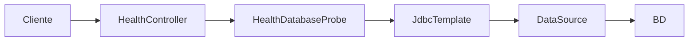
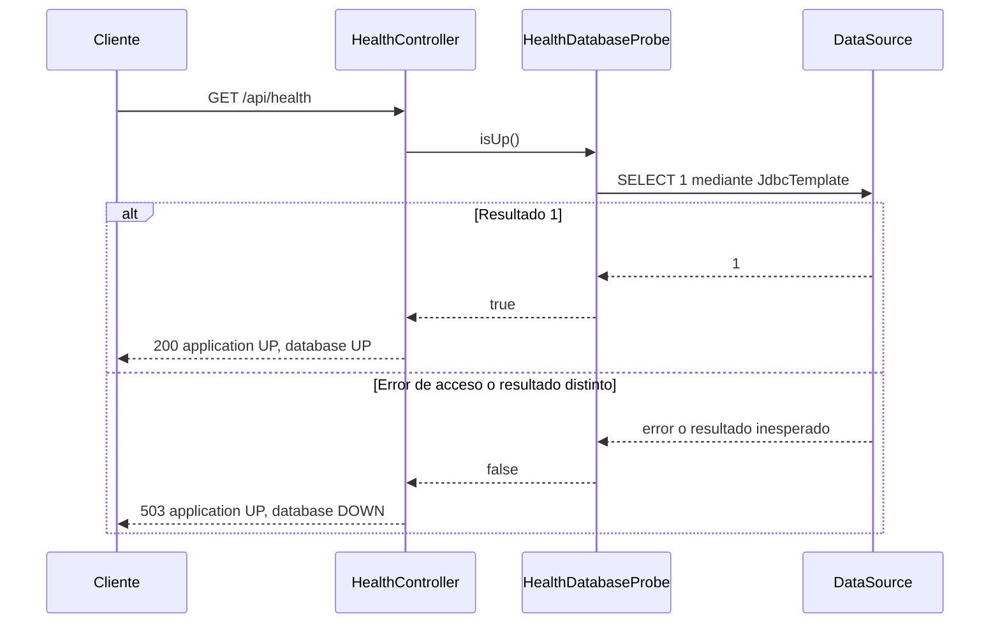

## Architecture Analysis

### System Overview

El área inspeccionada pertenece a una aplicación Java Spring Boot; el stack aspiracional Python/React de AGENTS.md no describe este módulo ejecutable.

### Architectural Style

La estructura enumera domain, application e infrastructure. Para salud, dos componentes de infraestructura resuelven la ruta sin lógica comercial ni cambios de esquema.

### Component Relationships

Alternativa textual: cliente → controlador → sonda → JdbcTemplate → DataSource → base de datos. Sintaxis Mermaid revisada manualmente.

### Data Flow

La sonda ejecuta SELECT 1 por petición y acepta únicamente el entero 1. DataAccessException produce estado negativo. El controlador traduce el resultado a HTTP 200/503, sin divulgar excepciones.

### Key Design Decisions

JdbcTemplate propio limita la consulta a 5 segundos sin modificar consultas comerciales. Cache-Control no-store evita reutilizar una respuesta de salud antigua. application=UP describe el proceso que pudo responder, no la disponibilidad de todas las dependencias.

### Improvement Opportunities

El timeout de consulta no garantiza un límite total para adquirir conexión. Verificar ese límite solo si se incorpora como requisito; no ampliar el feature por inferencia.

## Interaction Diagrams

Alternativa textual: la petición consulta la BD; éxito devuelve 200 y UP/UP, fallo devuelve 503 y UP/DOWN. Sintaxis revisada manualmente.
